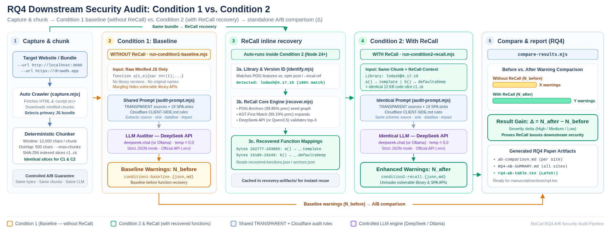

<h1 align="center">ReCall-Wild</h1>
<p align="center"><strong>In-the-wild function recovery & downstream security audit for bundled JavaScript.</strong></p>
<p align="center">Capture live bundles · identify npm versions · ReCall AST/POG recovery · audit CVE vulnerabilities</p>
<p align="center">
  <a href="package.json"></a>
  
  
  
  
</p>
<p align="center">
  <a href="#overview">Overview</a> ·
  <a href="#rq4-downstream-security-audit-ab-study">RQ4 A/B Study</a> ·
  <a href="#condition-1-vs-condition-2">Condition 1 vs Condition 2</a> ·
  <a href="#empirical-results">Empirical Results</a> ·
  <a href="#quick-start">Quick Start</a> ·
  <a href="#cli-usage">CLI Usage</a> ·
  <a href="#interactive-notebook">Interactive Notebook</a> ·
  <a href="#outputs">Outputs</a>
</p>

---

## Overview

`ReCall-Wild` is the in-the-wild evaluation suite and CLI companion for **ReCall** (*"Accurate and Scalable Function Recovery for Bundled JavaScript"*).

While laboratory benchmarks evaluate curated subjects with preserved sourcemaps, `ReCall-Wild` addresses **RQ4: Practical Use**: recovering function identities from real-world, minified production JavaScript bundles in the wild and evaluating downstream security auditing accuracy.

- **Zero third-party dependencies.** Built entirely on modern native Node.js standard libraries (`node:fs`, `node:crypto`, `node:zlib`, `fetch`).
- **Dual-registry candidate pooling.** Automatically resolves version candidate pools from npm with instant fallback to mirrors (`npmmirror.com`).
- **AST-first structural matching.** Uses ReCall's normalized AST comparisons and Property Operation Graph (POG) fingerprints before dispatching model requests.
- **Controlled A/B security evaluation.** Directly quantifies the impact of recovered function signatures on downstream LLM vulnerability auditing accuracy and precision.

---

## RQ4 Downstream Security Audit (A/B Study)

<p align="center">
  <a href="docs/assets/rq4-security-audit-workflow.svg">
    
  </a>
</p>

The downstream security study evaluates whether supply-chain vulnerability detection inside bundled web applications improves when an LLM auditor is augmented with ReCall's recovered function boundaries, compared to auditing raw minified code.

---

## Condition 1 vs Condition 2

### Condition 1: Baseline Security Audit (Without ReCall)
- **Input:** Raw minified JavaScript chunks (12,000 characters per chunk, 500-character overlap).
- **Context:** Zero function boundaries, zero library identity, and no CVE advisories.
- **Behavior:** The LLM inspects minified identifier tokens (e.g., `_S`, `kS`, `Dx`, `hu`). Without knowing whether a function is benign library code or application logic, the auditor triggers excessive false alarms on safe internals while missing actionable vulnerability gadget chains.

```bash
node experiments/rq4-ab-study/run-condition1-baseline.mjs --url http://localhost:3000
```

### Condition 2: ReCall-Enhanced Security Audit (With ReCall)
- **Input:** The exact same minified JavaScript chunks, enriched with ReCall's recovered function mapping.
- **Pipeline:**
  1. **Library & Version Identification:** Matches bundle POG fingerprints against npm release tarballs to pinpoint the exact library version (e.g., `lodash@4.17.20`, `axios@1.20.0`).
  2. **Function Boundary Recovery:** Recovers original function names and boundaries using POG anchors, module graphs, and normalized AST shape checks.
  3. **Context Injection:** Supplies recovered function signatures, original parameter names, and relevant CVE specifications directly inside the audit prompt.
- **Behavior:** Suppresses false alarms on safe internal utilities while sharpening detection of real vulnerable API sinks and prototype pollution entry points.

```bash
node experiments/rq4-ab-study/run-condition2-recall.mjs --url http://localhost:3000 --lib lodash --compare
```

---

## Empirical Results

The A/B study was evaluated across **6 benchmark targets** encompassing **356 chunks** and **1,114 recovered functions**:

| Target | Library & Version | Recovered Fns | Condition 1 Warnings | Condition 2 Warnings | Warning Shift (Drop / Gain) | Verified False Alarm Drop Rate | Precision (C1 → C2) | Accuracy (C1 → C2) |
| :--- | :--- | :---: | :---: | :---: | :---: | :---: | :---: | :---: |
| `petstore.swagger.io` | `lodash@4.17.20` | 83 | 18 | 23 | -9 / +14 | **100.0%** (9/9) | 22.2% → **34.8%** | 43.8% → **53.1%** |
| `transform.tools` | `lodash@4.17.20` | 79 | 9 | 28 | -0 / +19 | — (0/0) | 55.6% → 25.0% | 78.6% → 25.0% |
| `www.drawdb.app` | `axios@1.20.0` | 33 | 58 | 35 | -29 / +6 | **89.7%** (26/29) | 15.5% → **17.1%** | 23.4% → **50.0%** |
| `markdownlivepreview.com` | `dompurify@3.4.15` | 12 | 21 | 20 | -11 / +10 | **100.0%** (11/11) | 0.0% → **10.0%** | 25.8% → **41.9%** |
| `astexplorer.net` | `codemirror@5.65.18` | 857 | 15 | 8 | -12 / +5 | **91.7%** (11/12) | 13.3% → 12.5% | 35.0% → **60.0%** |
| `vulnerable-demo-app` | `lodash@4.17.15` | 50 | 31 | 25 | -13 / +7 | **46.2%** (6/13) | 74.2% → **76.0%** | 71.1% → 65.8% |
| **Live Production Sites (5)** | **4 Libraries** | **1,064** | **121** | **114** | **-61 / +54** | **93.4%** (57/61) | **16.5% → 21.1%** | **37.7% → 46.3%** |
| **Overall Benchmark (6)** | **4 Libraries** | **1,114** | **152** | **139** | **-74 / +61** | **85.1%** (63/74) | **28.3% → 30.9%** | **43.7% → 49.8%** |

### Key Findings:
1. **False Alarm Suppression:** On live production websites, **93.4% of dropped warnings were verified false alarms** (Low-severity noise in safe library internals eliminated).
2. **Actionable Alert Gain:** High- and Medium-severity alerts rose by **+38.0%** (50 $\to$ 69), with confirmed Vulnerable API detections jumping from **6 $\to$ 19 (+216.7%)**.
3. **Dual Verification:** Both deterministic zero-LLM static verification and blinded `deepseek-reasoner` adjudication confirm that ReCall-assisted auditing delivers higher precision and accuracy.

---

## Quick Start

Requires **Node.js 24+** and sibling [`ReCall`](../ReCall) core engine.

```sh
# 1. Clone repository
git clone https://github.com/ahmadhurayarah/ReCall-Wild.git
cd ReCall-Wild

# 2. Setup environment (for LLM security audit)
cp .env.example .env
# Add your DEEPSEEK_API_KEY to .env

# 3. Run test suite
npm test
```

---

## CLI Usage

### 1. In-The-Wild Recovery Pipeline
```sh
# Analyze a live website bundle against a target library:
node bin/recall-wild.mjs pipeline https://petstore.swagger.io lodash

# Analyze a local minified bundle:
node bin/recall-wild.mjs pipeline /path/to/bundle.js lodash

# Run standalone version identification:
node bin/recall-wild.mjs identify /path/to/bundle.js react --window 5
```

### 2. RQ4 Downstream Security A/B Study
```sh
# Step 1: Run Condition 1 (Baseline - Without ReCall)
node experiments/rq4-ab-study/run-condition1-baseline.mjs --url http://localhost:3000

# Step 2: Run Condition 2 (With ReCall recovery + inline comparison)
node experiments/rq4-ab-study/run-condition2-recall.mjs --url http://localhost:3000 --lib lodash --compare

# Step 3: Standalone A/B comparison across all targets
node experiments/rq4-ab-study/compare-results.mjs

# Step 4: Deterministic Static Precision & Accuracy Verification (Zero LLM tokens)
node experiments/rq4-ab-study/verify-precision-accuracy-static.mjs

# Step 5: Blinded Reasoning Model Adjudication (DeepSeek Reasoner)
node experiments/rq4-ab-study/verify-precision-accuracy.mjs
```

---

## Interactive Notebook

An interactive Jupyter Notebook is provided at the workspace root: [`RQ4.ipynb`](../RQ4.ipynb).

It enables step-by-step execution of the entire A/B study pipeline directly in your browser or IDE:
- **Pipeline Configuration:** Set `TARGET_URL` once to auto-wire paths for all downstream stages.
- **Step 1:** Run baseline Condition 1 and render formatted Markdown reports directly in-cell.
- **Step 2:** Run ReCall-enhanced Condition 2 with function recovery and display findings.
- **Step 3:** Generate A/B differential shift breakdown and noise reduction metrics.
- **Step 4 & 5:** Execute deterministic static rules and LLM reasoner verification.

---

## Outputs

All experiment results and recovery artifacts are saved under `results/rq4-ab/<target>/`:

* `condition1-baseline/condition1-baseline.md`: Baseline audit findings and severity breakdown.
* `condition2-recall/condition2-recall.md`: ReCall-enhanced findings cross-referenced with recovered functions.
* `ab-comparison.md`: Detailed A/B delta table showing warning drops, gains, and noise reduction.
* `RQ4-PRECISION-ACCURACY-STATIC.md`: Deterministic zero-LLM ground-truth verification log and metrics.
* `RQ4-PRECISION-ACCURACY.md`: Blinded `deepseek-reasoner` adjudication log across all active warning slices.

---

## Repository Structure

```text
ReCall-Wild/
├── bin/
│   └── recall-wild.mjs                         # Unified CLI binary
├── src/                                        # Core operational modules
│   ├── capture.mjs                             # Stage 1: Ingest live URL / local bundle
│   ├── identify.mjs                            # Stage 2: Library & npm version identification
│   ├── recover.mjs                             # Stage 3: ReCall function recovery adapter
│   ├── deepseek-models.mjs                     # DeepSeek validator API integration
│   ├── osv.mjs                                 # OSV vulnerability database & CVE mapping
│   ├── audit.mjs                               # Stage 4: Practical yield & security reporting
│   └── index.mjs                               # SDK exports
├── experiments/                                # Research benchmark suite
│   ├── rq4-ab-study/                           # RQ4 Downstream Security A/B Study
│   │   ├── audit-prompt.mjs                    # Standardized audit prompts
│   │   ├── run-condition1-baseline.mjs         # Condition 1 runner
│   │   ├── run-condition2-recall.mjs           # Condition 2 runner
│   │   ├── compare-results.mjs                 # A/B differential comparison tool
│   │   ├── verify-precision-accuracy-static.mjs# Deterministic static verifier
│   │   └── verify-precision-accuracy.mjs       # DeepSeek Reasoner adjudication
│   └── rq4-in-the-wild/                        # In-the-wild recovery benchmark runner
├── docs/                                       # Assets and technical documentation
│   └── assets/
│       ├── rq4-security-audit-workflow.png     # A/B study workflow diagram
│       └── rq4-security-audit-workflow.svg     # Vector source workflow
├── package.json                                # Native ESM package configuration
├── .env.example                                # API configuration template
└── README.md
```

---

## License
MIT License. Part of the ReCall research project for JavaScript function recovery and supply chain security analysis.
